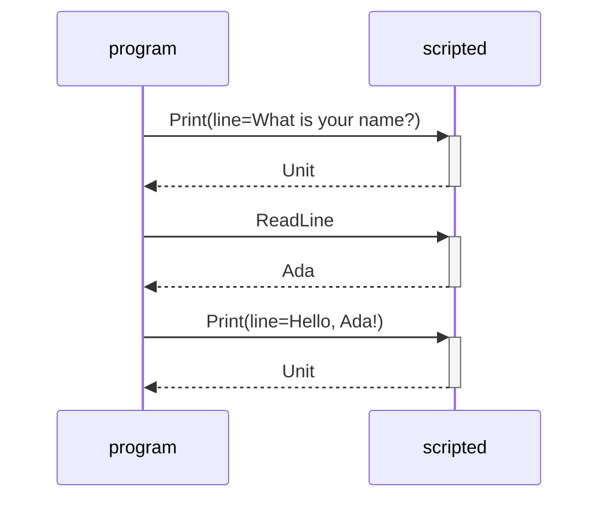
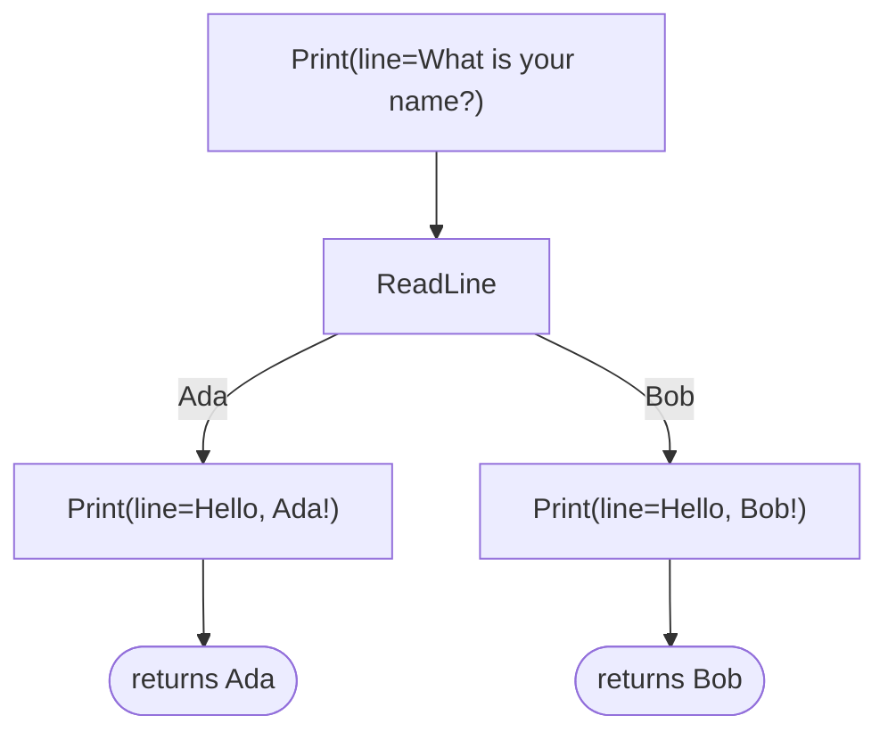

# Freer

[](https://github.com/BenjaminEarley/Freer/actions/workflows/ci.yml)

Extensible effects for Kotlin Multiplatform, after [Freer Monads, More Extensible Effects](https://okmij.org/ftp/Haskell/extensible/more.pdf) by Kiselyov and Ishii. A `Program` is an immutable value describing a computation and its effects; handlers applied afterwards decide what each effect does, so one flow runs against real services, scripted handlers, a dry run or audit middleware, unchanged. Each effect is reified with its continuation, so a program is replayable, interceptable and resumable more than once on every target, for one small allocation per effect.

API reference (KDoc): [benjaminearley.github.io/Freer](https://benjaminearley.github.io/Freer/).

## Installation

Add `implementation("com.benjaminearley:freer:0.3.0")` to a common source set or any JVM module. Targets: JVM, Wasm, macOS, iOS, Linux and Windows. Everything is common code except `ioBlocking()`, which is JVM-only. `com.benjaminearley:freer-trace`, JVM-only, records, replays, stores and draws program runs.

## Quick Example

A sealed interface declares an effect family, a program performs its effects, a handler answers them. One program, a scripted handler for the test, a real one for production:

```kotlin
import com.benjaminearley.freer.*

sealed interface Console<out R> : Effect<R>
data class Print(val line: String) : Console<Unit>
data object ReadLine : Console<String>

val greeter: Program<String> = program {
    Print("What is your name?").bind()
    val name = ReadLine.bind()
    Print("Hello, $name!").bind()
    name
}

fun <A> Program<A>.console(): Program<A> = handle<Console<*>, A> { op ->
    when (op) {
        is Print -> println(op.line)
        ReadLine -> readlnOrNull() ?: "stranger"
    }
}

fun <A> Program<A>.scripted(input: String, printed: MutableList<String>): Program<A> =
    handle<Console<*>, A> { op ->
        when (op) {
            is Print -> { printed += op.line }
            ReadLine -> input
        }
    }

fun main() {
    val printed = mutableListOf<String>()
    val name = greeter.scripted("Ada", printed).runOrThrow()
    check(name == "Ada" && printed == listOf("What is your name?", "Hello, Ada!"))
    greeter.console().runOrThrow()
}
```

CI runs these blocks and checks the diagrams they print.

<details>
<summary>The greeter traced, explored and drawn with freer-trace</summary>

The same program under the JVM-only `com.benjaminearley:freer-trace` artifact: one run observed between the greeter and the scripted handler, then every path of the greeter under two names.

```kotlin
import com.benjaminearley.freer.runOrThrow
import com.benjaminearley.freer.trace.*
import com.benjaminearley.freer.trace.mermaid.flowchart
import com.benjaminearley.freer.trace.mermaid.sequenceDiagram

fun main() {
    val trace = Trace(last = "scripted")
    greeter.observed("program", trace).scripted("Ada", mutableListOf()).runOrThrow()
    println(trace.sequenceDiagram())
    println(greeter.tree { ofType<String>("Ada", "Bob") }.flowchart())
}
```





</details>

## Core Concepts

Inside `program { }`, `.bind()` runs a sub-program or performs an effect; `perform(effect)` is the effect as a program, for `flatMap` chains. `runOrThrow()` and `run()` extract the value once every effect is handled. A handler is applied lazily, dispatches on the erased effect class (match the star-projected family) and removes the effects it answers. Five forms:

| Form | The rule receives | Use it for |
| --- | --- | --- |
| `handle` | the effect; its return value is the response | most handlers |
| `handleS` | the state and the effect; returns `newState to response`; seeded by its argument | handler-local state |
| `intercept` | the effect and `proceed()`, which re-emits it downstream | middleware: audit, retry, rewrite |
| `interpret` | the effect and `resume`, the rest of the program as a value | abort, multi-shot, generators |
| `interpretS` | the state, the effect and `resume(state, response)` | stateful control flow |

Built-in effects, in `com.benjaminearley.freer.effects`: `State`, `Reader`, `Failure` (`raise`, `attempt`, `recover`), `NonDet` (multi-shot `choose`, `msplit`, `once`, `ifte`), generators and `IO` (`performIO`, run at the edge by `io()` or `ioBlocking()`). Their KDoc says how to order them and what is unchecked.

## Semantics

The interpreter is checked against a specification: a tree interpreter transcribing the paper's [Eff1.hs](https://okmij.org/ftp/Haskell/extensible/Eff1.hs) in `freer/src/commonTest/kotlin/com/benjaminearley/freer/reference/`. The paper's examples run as golden tests through both (`PaperExamplesTest.kt`), and the monad, state, reader, nondeterminism and handler-order laws run as [kotest](https://kotest.io/docs/proptest/property-based-testing.html) properties over random programs under random handler stacks on every target (`laws/`); the library must agree with the model (`DifferentialTest.kt`). The laws follow [Wadler](https://homepages.inf.ed.ac.uk/wadler/topics/monads.html), [Gibbons and Hinze](https://www.cs.ox.ac.uk/jeremy.gibbons/publications/mr.pdf), [Plotkin and Pretnar](https://arxiv.org/abs/1312.1399) and [LogicT](https://okmij.org/ftp/Computation/LogicT.pdf). One program may be interpreted from many threads at once (`ConcurrentInterpretationTest.kt`, and `jcstress/` on the JVM). [Pitest](https://pitest.org) mutation testing gates CI at the score set in `freer/build.gradle.kts`, which classifies the survivors.

## Performance

Per effect, with JMH on the v0.2.0 code, JDK 21, Apple silicon (`freer/src/jvmBenchmark/`): `handle` costs 8.6 ns and 72 B, `interpret` 8.4 ns and 72 B, `intercept` then `handle` 64 ns and 472 B, and a raw suspend loop 4.3 ns and 0 B; JDK 17 allocates 144 B for `handle`. The gap to the raw loop is the reified continuation, which [evidence passing](https://doi.org/10.1145/3473576) and [runtime continuations](https://arxiv.org/abs/2104.00250) avoid in the tail-resumptive case, and which buys replay, interception and multi-shot resumption. Bind chains are linear in either association (`BindChainBenchmark.kt`). A hundred thousand effects through stacked handlers, recursion and multi-shot searches run on a constant stack (`TrampolineScenarios.kt`, `SmallStackTest.kt`); the one stack bound is the number of nested handlers, three JVM frames per level (`StackDepthTest.kt`, `NestingDepthTest.kt`).

## Project layout

- `freer/` is the library: common code in `src/commonMain/`, tests in `src/commonTest/` (`reference/`, `laws/`) and `src/jvmTest/`, JMH in `src/jvmBenchmark/`, API dumps in `api/`.
- [`freer-trace/`](freer-trace/README.md) is the trace module: trace and tree of a program, replay, text form, Mermaid renderers, laws against the reference model.
- `examples/` is a JVM demo of middleware, async I/O, error handling, generators, nondeterminism, transactions and [Mermaid diagrams](examples/README.md) (`./gradlew :examples:run`).
- `jcstress/` stress-tests shared programs across threads.
- `.github/workflows/` runs CI on Linux, macOS and Windows, publishes the API reference and releases from tags.

## Contributing / Releasing

```sh
./gradlew check                 # tests, API check, README checks
./gradlew :examples:run         # the demo
./gradlew :freer:jvmBenchmark   # JMH (jvmSmokeBenchmark for a quick pass)
./gradlew :jcstress:run         # JCStress
./gradlew :freer:pitest         # mutation testing, report in freer/build/reports/pitest
./gradlew :dokkaGenerate        # the API reference of both modules, in build/dokka/html
```

A public API change needs `./gradlew updateKotlinAbi` and the dumps committed. To release, push a tag `v1.2.3` on a main-branch commit; the workflow runs the checks, publishes both modules to Maven Central and creates the release.

## License

[MIT](LICENSE)
