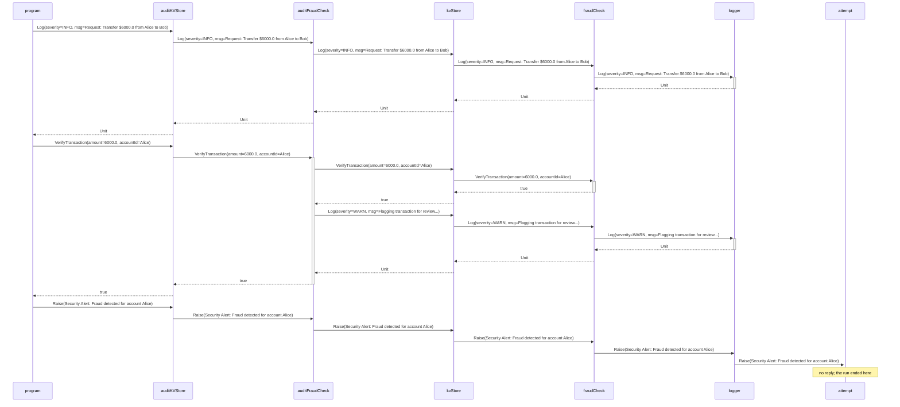
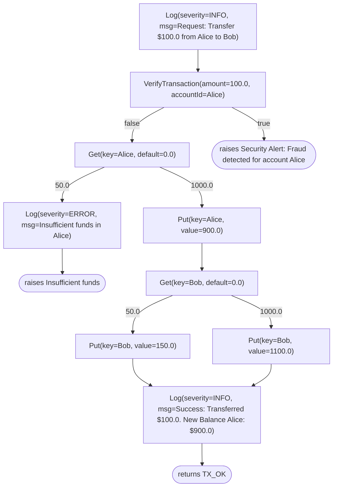

# Examples

`./gradlew :examples:run` runs every scenario of the demo in sequence, from `src/main/kotlin/com/benjaminearley/freer/examples/Main.kt`: accounting with audit middleware, async I/O and error handling, bind-chain performance, error recovery, handler ordering, generators, nondeterminism, transactions, reader overrides, committed choice, and the diagrams below.

The diagrams are the output of the last scenario, `Diagrams.kt`, which draws the accounting program two ways with the `freer-trace` module. A program is a value: a tree whose nodes are the effects it performs and whose edges are the responses it may receive. The handlers applied to it decide what each effect does, so a diagram is one more interpretation of the value, and the two below denote different things. This page is generated; `check` fails when it is stale, and `./gradlew :examples:updateDiagrams` regenerates it. CI parses both diagrams with Mermaid's own parser.

## One run as a sequence diagram

A run of transferMoney("Alice", "Bob", 6000.0) under the production stack, as a sequence diagram: the operational trace of one run under one handler stack, recorded by an observer between every two handlers. Each effect passes down from the program to the handler that answers it, and its response comes back up. A handler that only passes an effect on is drawn as a relay; one that answers it, or performs effects of its own before replying, is activated until its reply. The fraud verdict comes back up through the audit middleware, which logs a warning of its own into the stack below it before replying. The failure reaches the last handler and never gets a reply, because that handler ends the run.

## Every path as a flowchart

Every path of transferMoney("Alice", "Bob", 100.0), as a flowchart: the program's tree, unfolded under every response of each effect. Boolean, enum, sealed-object and Unit responses are enumerated from the effect's response type. A balance read answers with its type parameter, which its default value witnesses as a `Double`; that has no finite set of values, so the read is unfolded under two representatives, 50.0 and 1000.0. A failure has no response, so it ends its path. No handler is applied: a stand-in answers each effect and the program is replayed once per path. Identical subtrees are drawn once. A representative that opened no path of its own, every effect and outcome below it being reachable through a sibling: `Get(key=Bob, default=0.0)` answered `1000.0`.

