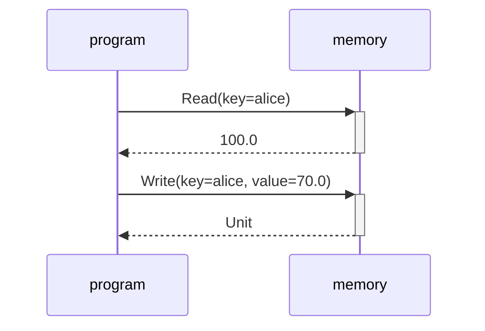
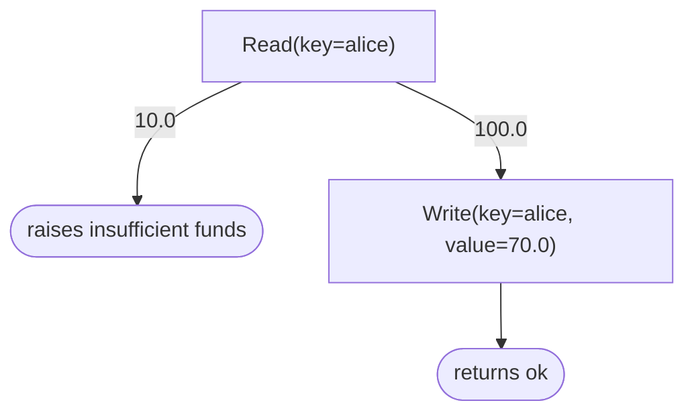

# Freer Trace

Traces of [Freer](../README.md) programs, on the JVM. A `Program` is a value whose effects are answered by whichever handlers are applied to it, so an interpretation can look at a program instead of running it. This module has five: a run recorded as a trace, every path unfolded as a tree, a trace replayed as a test, a trace stored as text, and both drawn as Mermaid diagrams.

API reference (KDoc): [benjaminearley.github.io/Freer/freer-trace](https://benjaminearley.github.io/Freer/freer-trace/).

## Installation

Add `implementation("com.benjaminearley:freer-trace:0.3.0")` to a JVM module, JVM 11 or later. It brings `freer` and kotlin-reflect, for response types.

## Quick Example

An effect family, a program and a handler; one run recorded, replayed and stored; every path unfolded:

```kotlin
import com.benjaminearley.freer.*
import com.benjaminearley.freer.effects.attempt
import com.benjaminearley.freer.effects.raise
import com.benjaminearley.freer.trace.*
import com.benjaminearley.freer.trace.mermaid.flowchart
import com.benjaminearley.freer.trace.mermaid.sequenceDiagram

sealed interface Store<out R> : Effect<R>
data class Read(val key: String) : Store<Double>
data class Write(val key: String, val value: Double) : Store<Unit>

fun withdraw(key: String, amount: Double): Program<String> = program {
    val balance = Read(key).bind()
    if (balance < amount) raise("insufficient funds").bind()
    Write(key, balance - amount).bind()
    "ok"
}

fun <A> Program<A>.memory(data: MutableMap<String, Double>): Program<A> = handle<Store<*>, A> { op ->
    when (op) {
        is Read -> data.getOrDefault(op.key, 0.0)
        is Write -> { data[op.key] = op.value }
    }
}

fun main() {
    // One run, observed between the program and its handler; then the same program
    // replayed from the trace with no handler at all, and the trace through its text form.
    val trace = Trace(last = "memory")
    val data = mutableMapOf("alice" to 100.0)
    val result = withdraw("alice", 30.0).observed("program", trace).memory(data).attempt().runOrThrow()
    check(result.getOrThrow() == "ok" && data["alice"] == 70.0)
    check(withdraw("alice", 30.0).replay(trace).runOrThrow() == "ok")
    check(Trace.parse(trace.toText()).sequenceDiagram() == trace.sequenceDiagram())

    // Every path. Unit and the failure need no help; a Double response needs representatives.
    val tree = withdraw("alice", 30.0).tree { ofType<Double>(10.0, 100.0) }
    check(tree.paths().map { it.end.outcome() } == listOf("raises insufficient funds", "returns ok"))
    println(trace.sequenceDiagram())
    println(tree.flowchart())
}
```

CI runs this block and checks it prints the diagrams below.

<details>
<summary>Printed diagrams</summary>





</details>

## Core Concepts

A `Trace` is the operational trace of one run under one handler stack. `observed` fits between any two layers and records every effect going down and every response coming up. `calls` gives the trace as nested calls, each with its effect, its response, the calls made meanwhile, and `relayed` when its participant only passed the effect on; the participant below the last observer is `last`.

A `Tree` is the program itself, unfolded. `tree` answers every effect with every value of its response type when that is finite (Boolean, an enum, a sealed hierarchy of objects, Unit), with the representatives you name when it is not, and ends the path at an effect that can have no response, such as a failure. Name representatives by response type with `ofType`, by effect family with `ofEffect`, which wins, or with a rule; a type parameter counts as the type of the property that witnesses it, and every representative is type-checked. The program is replayed from the start once per path, so it must be a function of its answers and finish under every answer. `paths` lists the paths and `redundantResponses` the representatives that opened none of their own.

`replay` answers a program from a trace or a path: the program's own code computes the result, the first effect that differs from the recording fails, and the effect the recording left unanswered is passed on.

`toText` and `Trace.parse` store a trace one wire per line. Literals stay typed (null, Unit, Boolean, numbers, String) and replay; anything else comes back as a `Described` stand-in that draws and compares like the original.

`sequenceDiagram` draws a trace with the working handler activated and an unanswered effect marked; `flowchart` draws a tree with identical subtrees shared; `mermaidLabel` escapes everything Mermaid reads as syntax. Both use only the public model, so another backend can sit beside them.

Two limits: effects without an equality of their own compare by class and description, and a trace is well nested only for single-shot runs, so a multi-shot handler below an observer breaks it.

Why a trace and a tree rather than string diagrams: a monad over-sequentialises, and the independence of two effects cannot be recovered from monadic code, as Bernardy and Spiwack argue in [Evaluating Linear Functions to Symmetric Monoidal Categories](https://arxiv.org/abs/2103.06195); drawing a program as one more interpretation of it follows Elliott's [Compiling to Categories](https://conal.net/papers/compiling-to-categories/).

## Checks

The explorer is checked against the library's specification interpreter on its random programs: every leaf is what the model computes under a handler answering from that path, and the leaves are the model's enumeration of every answer assignment (`TreeLawsTest.kt`). Every diagram the tests generate, this README's and the [examples page](../examples/README.md) pass Mermaid's own parser in CI. The examples' transfer flow uses its tree as a test oracle (`TransferMoneyOracleTest.kt`).

## Project layout

- `src/main/` holds the model in `trace/` and the renderers in `trace/mermaid/`; `src/test/` the tests; `api/` the API dump.
- `../examples/` draws, explores and replays a transfer flow (`./gradlew :examples:run`), generating `../examples/README.md`.

## Contributing

```sh
./gradlew :freer-trace:check   # tests and the API check
```

A public API change needs `./gradlew :freer-trace:updateKotlinAbi` and the dump committed. One tag releases both artifacts.

## License

[MIT](../LICENSE)
